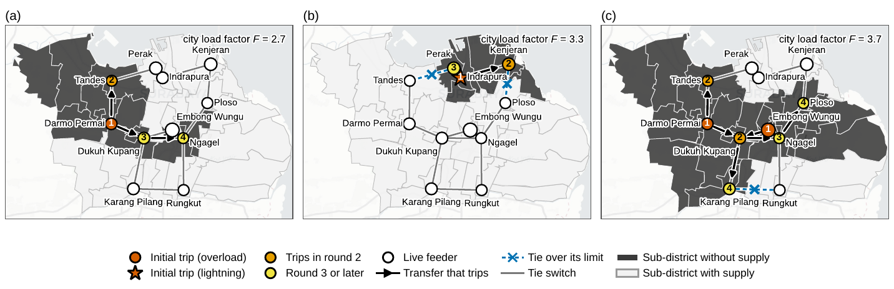
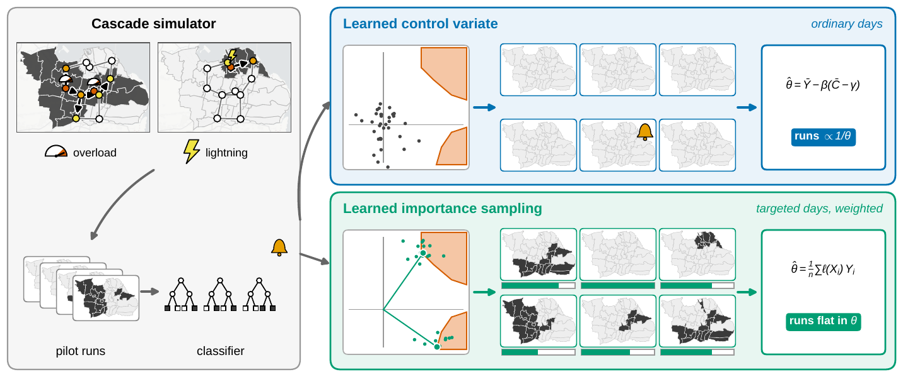
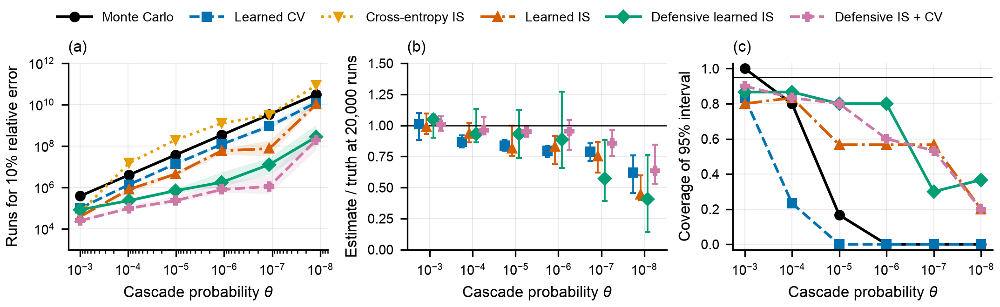
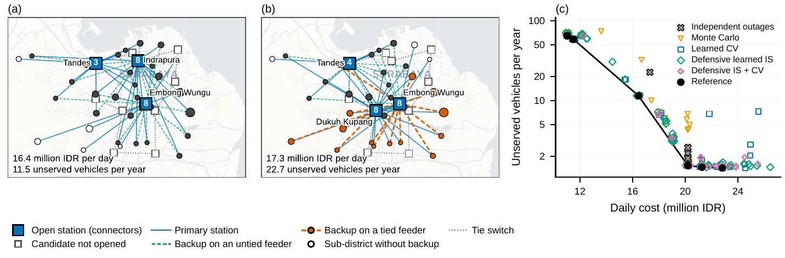

# Rare-event benchmarks for EV charging under cascading feeder outages

Code, data and results for the paper

> M. M. Arief, S. Iyanda, G. Mahardikana, H. E. Bouslimane and Y. P. Akhra,
> "Learning-Based Rare-Event Estimators for Safe EV Chargers Planning under Cascading Outages,"
> 2026 (still under review).

The repository reproduces every number, table and figure in the paper. The scripts write the
figures and tables into `figs/` and `tables/`.

## What the study does

A public charging station is out of service on a day when its feeder trips. We model the 11
candidate feeders of Surabaya, Indonesia, with load transfer through 13 tie switches and with
lightning-initiated trips. A tripped feeder hands part of its load to its tied neighbours and can
trip them in turn. The rare event is a day with at least three feeders down.



*Three simulated cascade days: an overload-initiated cascade, a lightning-initiated trip
contained by the tie switches, and a city-wide cascade with four rounds of trips.*

One learned classifier of this event is used in two ways.

* **Learned control variate (CV).** The simulator runs on ordinary days. The classifier alarm,
  whose mean is known from classifier calls only, corrects the Monte Carlo average.
* **Learned importance sampling (IS).** The simulator runs on days drawn around the dominating
  points of the learned set, and each day is weighted by its likelihood ratio. A defensive
  version widens the proposal, and a combined estimator uses the alarm as a control under IS.



*One classifier, two estimators: as a control variate on ordinary days (top) and as the
target set of an importance-sampling proposal with weighted days (bottom).*

Eight estimators are benchmarked at cascade probabilities from 1e-3 to 1e-8 with 20,000
simulator runs each. The estimated joint outage probabilities then feed a siting model with a
backup station per sub-district, and every design is evaluated with a reference matrix.



*The rarity sweep: simulator runs needed for 10% relative error, bias at 20,000 runs, and
coverage of the nominal 95% intervals, for each estimator across six rarity levels.*



*Siting designs under the reference probabilities and under independence, and the
cost--unserved-vehicles frontier of the designs produced by each estimator.*

## Layout

| Path | Content |
|---|---|
| `src/cascade/model.py` | Cascading feeder-trip simulator (23 standard normal inputs, 11 feeders, 13 ties, lightning trips) |
| `src/cascade/features.py` | Physical features for the classifier (standardised feeder loads and stroke severities) |
| `src/cascade/pipeline.py` | Pilot stage with active rounds, the learned set, and all eight estimators |
| `src/cascade/sampling.py` | Gaussian mixture proposals, sampled dominating points, reference estimator |
| `src/cascade/siting.py` | Siting MILP with a backup station per sub-district (HiGHS through SciPy) |
| `src/cascade/figstyle.py` | Figure style (embedded TrueType fonts, colour-blind-safe palette) |
| `scripts/` | One script per experiment or figure (see below) |
| `data/` | Surabaya stations, demand, travel times and costs, and the basemap |
| `results/` | Raw outputs of the experiments, as used in the paper |
| `figs/`, `tables/` | Figures (PDF and PNG) and the sweep table drawn from `results/` |

## Install

Python 3.10 or later.

```bash
python -m pip install -r requirements.txt
```

## Reproduce

### Figures and tables from the shipped results (about 2 minutes)

```bash
make figures
```

This downloads the sub-district boundaries (once) and redraws the four figures and Table I
from `results/` into `figs/` and `tables/`. The figures are identical to those in the paper.

### Full experiments

```bash
make levels       # optional, recalibrates results/levels.json (about 30 minutes)
make -j6 benchmark  # rarity sweep, 30 replications per level (about 25 minutes per level on one core)
make frontier     # siting designs under each estimator (about 30 minutes)
make figures
```

All runs use fixed seeds. Every script sets `OMP_NUM_THREADS=1`, since the boosted-tree
classifier slows down from thread oversubscription when several levels run in parallel. To try
a run without touching the shipped results, set a scratch folder, for example
`RESULTS_DIR=/tmp/check python scripts/run_benchmark.py 0 1`.

### Where each result comes from

| Paper element | Script | Inputs | Output |
|---|---|---|---|
| Headroom per rarity level | `scripts/calibrate_levels.py` | model | `results/levels.json` |
| Rarity sweep (Section V-B) | `scripts/run_benchmark.py LEVEL REPS` | `results/levels.json` | `results/benchmark_level{0..5}.json` |
| Siting designs (Section V-C) | `scripts/run_frontier.py` | model, `data/` | `results/frontier.json` |
| Fig. 3, Table I, quoted numbers | `scripts/make_figures.py` | benchmark and frontier results | `figs/fig_sweep.pdf`, `tables/tab_sweep.tex`, `results/summary.json`, `results/frontier_summary.json` |
| Fig. 1 and Fig. 4 | `scripts/make_maps.py` | `results/frontier.json`, boundaries | `figs/fig_cascade.pdf`, `figs/fig_designs.pdf`, `results/cascade_examples.json`, `results/design_maps.json` |
| Fig. 2 | `scripts/make_framework.py` | `results/cascade_examples.json`, boundaries | `figs/fig_framework.pdf` |
| Sub-district polygons | `scripts/fetch_boundaries.py` | GADM 4.1 (download) | `data/boundaries/surabaya_kecamatan.geojson` |

`make_figures.py` prints every quantity that the text quotes, such as recall, precision, the
gap between rho^2 and the product of recall and precision, the realised estimates, the coverage
and the regret of the siting designs.

## Data and licences

* `data/stations.csv`, `data/demand.csv`, `data/travel_time.csv` and `data/params.json` are the
  Surabaya case of Akhra, Vanany and Arief (arXiv:2307.05470), taken from
  [ai-vnv/rare-event-ev-charging](https://github.com/ai-vnv/rare-event-ev-charging) under the MIT
  licence. Feeder loads are masked values from that study.
* The stroke-current distribution (log-normal, median 17.12 kA, log standard deviation 0.601)
  and the critical current of 219 kA are taken from Firdaus, Arla and Arief, ICT-PEP 2026,
  doi 10.1109/ICT-PEP71341.2026.11761588. The corridor of that study is a 70 kV line in West
  Java and is used here as a regional proxy.
* `data/basemap/surabaya_canvas.jpg` is rendered from CARTO basemap tiles, (c) CARTO,
  (c) OpenStreetMap contributors.
* The sub-district boundaries are GADM 4.1 polygons. GADM does not allow redistribution, so
  they are not in this repository. `scripts/fetch_boundaries.py` downloads them and checks the
  archive hash.
* The tie-switch graph, the transfer share (0.15), the tie pick-up limit (0.20) and the load
  correlation (0.3) are modelling assumptions and are not utility data.

The code is released under the MIT licence (see `LICENSE`).

## Related repositories

* [ai-vnv/rare-event-ev-charging](https://github.com/ai-vnv/rare-event-ev-charging): siting model
  with independent outages and a Gaussian-proxy control variate.

## Citation

```bibtex
@unpublished{arief2026cascade,
  author = {Mansur M. Arief and Sulyman Iyanda and Grisdy Mahardikana and Houssem Eddine Bouslimane and Yan Pratama Akhra},
  title  = {Learning-Based Rare-Event Estimators for Safe {EV} Chargers Planning under Cascading Outages},
  year   = {2026},
  note   = {Still under review}
}
```
